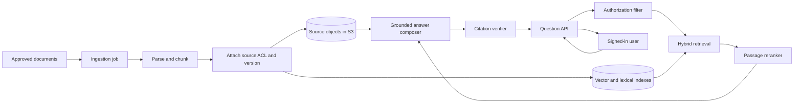

# KnowledgeMesh

**Development Status: In Progress**

Citation-first enterprise knowledge retrieval. This repository currently contains design documentation only. The architecture and features below are proposed; no application implementation is claimed.

## Overview

A permission-aware knowledge platform that answers questions with verifiable citations across documents.

## Problem

Teams store answers across fragmented documents. Keyword search misses context, while ungrounded AI answers can cite the wrong passage or reveal information across access boundaries.

## Proposed solution

Ingest a controlled document collection, preserve passage-level provenance and access metadata, then retrieve and rerank evidence before composing a cited answer. The system abstains when evidence is weak.

## Proposed tech stack

Python, FastAPI, S3, PostgreSQL with pgvector, document parsers, OpenSearch or lexical search, IAM; optional Amazon Bedrock for embeddings and answer synthesis.

## Proposed architecture

The [architecture](architecture.md) explains the data flow and boundaries. The [technical design](technical-design.md) defines the first build and evaluation approach.

## Development roadmap

See the [phased development roadmap](development-roadmap.md). It describes planned work without implying that any phase is complete.
