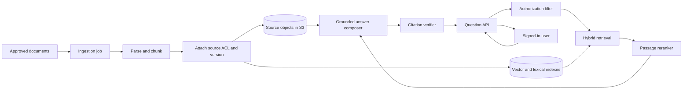

# KnowledgeMesh architecture

**Development Status: In Progress** — proposed design, not a deployed system.

## System diagram

## Data flow and boundaries

### Document identity
Each passage stores document ID, version, page or section, text offsets, checksum, and source permissions. Reingestion invalidates prior passage versions and removes deleted documents from both indexes.

### Query path
Authorize before retrieval; apply the user's access filter in both lexical and vector searches. Merge candidates, rerank, and supply only selected passages to the answer composer. Return citation links to exact passages and abstain when evidence cannot support the answer.

### MVP boundary
Start with a small public or synthetic corpus and one user role. Design access-control fields from day one, then test multiple roles before adding private enterprise connectors.

## Security and operating boundaries

Carry document permissions through every index record, prevent cross-tenant cache reuse, encrypt stored content, redact query logs, and test access filters with adversarial prompts.

## Initial deployment approach

Build the smallest local or low-cost proof of concept first. Introduce managed cloud services only after the data contracts and baseline evaluation work locally. Record configuration, dataset versions, and costs so results can be reproduced.
